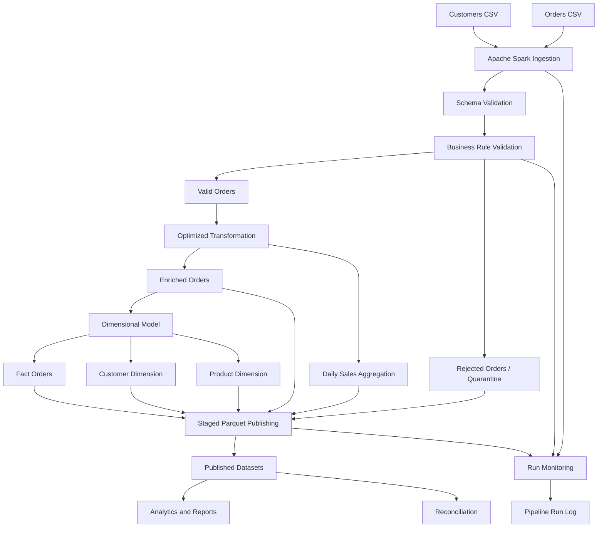

# YottaFlex Data Engineering Architecture

## 1. Architecture Overview

The pipeline uses Apache Spark to ingest customer and order datasets, validate records, transform valid data, build a dimensional model, and publish analytical outputs in Parquet format.

## 2. Data Flow Diagram



## 3. Main Components

| Component | Responsibility |
|---|---|
| Data Generator | Creates reproducible customer and order datasets |
| Ingestion | Reads CSV source datasets |
| Validation | Checks schemas, required fields, duplicates, and business rules |
| Quarantine | Stores rejected records and rejection reasons |
| Transformation | Derives order dates and transaction amounts |
| Aggregation | Calculates daily product sales metrics |
| Dimensional Model | Builds fact orders and customer/product dimensions |
| Publisher | Stages and publishes Parquet datasets |
| Reconciliation | Verifies input, valid, rejected, and aggregation counts |
| Monitoring | Records run status, duration, counts, and errors |
| Analytics | Produces business summary reports |

## 4. Storage Layout

- `data/generated/` – generated source datasets.
- `data/output/valid_orders/` – validated orders.
- `data/output/daily_sales/` – daily sales aggregation.
- `data/output/fact_orders/` – order fact dataset.
- `data/output/dim_customers/` – customer dimension.
- `data/output/dim_products/` – product dimension.
- `data/quarantine/rejected_orders/` – rejected records.
- `reports/` – monitoring, reconciliation, benchmark, and analytics reports.

## 5. Execution

The pipeline runs using Apache Spark in local mode through Docker.

Main command:

```powershell
docker run --rm `
  -v "${PWD}:/workspace" `
  -w /workspace `
  -e PYTHONPATH=/workspace `
  yottaflex-spark `
  /opt/spark/bin/spark-submit src/run_pipeline.py
```
